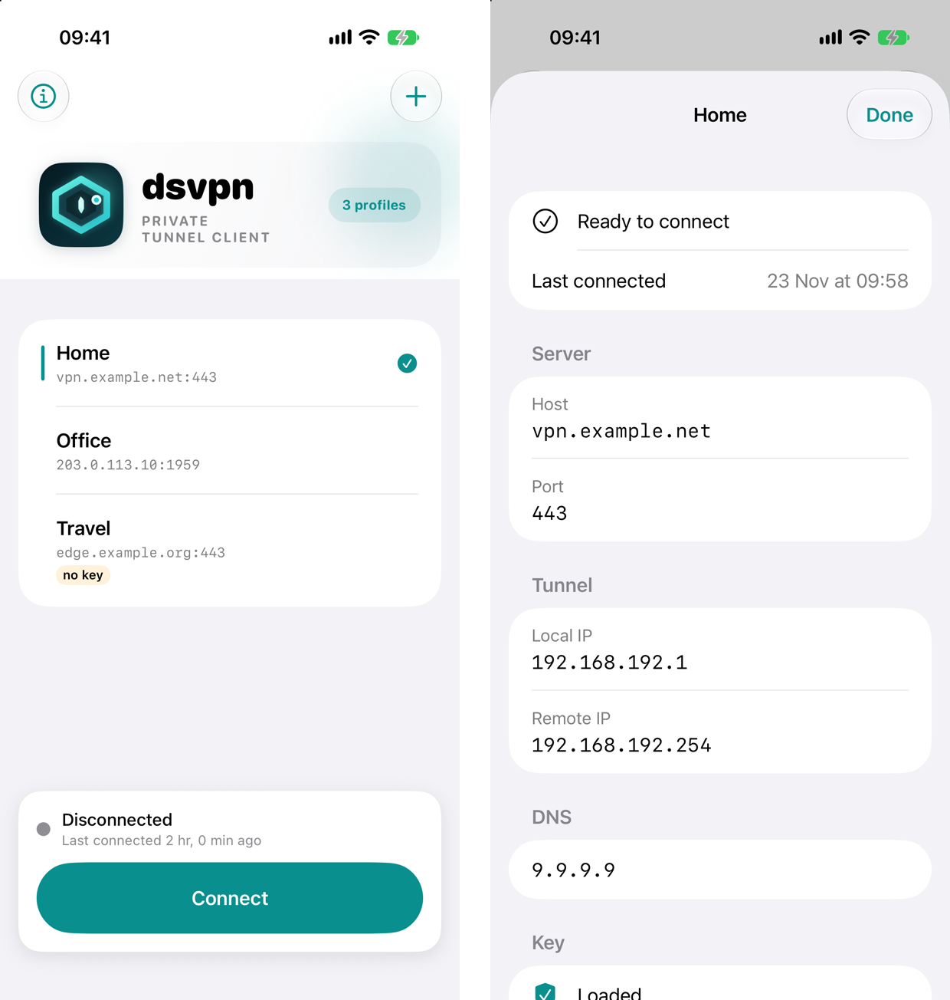

# dsvpn for iOS

An iOS client for [dsvpn](https://github.com/jedisct1/dsvpn), a Dead Simple VPN that runs over TCP.

It connects your iPhone or iPad to a dsvpn server so that all your traffic is routed through it. This is useful when you are on an untrusted or restricted network where only TCP traffic is allowed.

<p align="center">
  
</p>

## What you need

You need a `dsvpn` server already running somewhere. The server setup is covered in the [dsvpn documentation](https://github.com/jedisct1/dsvpn). In short, you run a single command on a Linux or macOS machine and you are done.

You also need a shared secret key. Generate one with:

```sh
dd if=/dev/urandom of=vpn.key count=1 bs=32
```

Copy this key to the server and keep it around for importing into the app later.

To build and install the iOS app, you need a Mac with Xcode and [Tuist](https://tuist.dev) installed. You can install Tuist with Homebrew:

```sh
brew install tuist
```

Finally, you need an Apple Developer account.

## Building from source

Clone the repository and generate the Xcode workspace:

```sh
git clone https://github.com/jedisct1/dsvpn-ios.git
cd dsvpn-ios
tuist generate
```

Before building, open `Project.swift` and replace the `DEVELOPMENT_TEAM` value with your own Apple Developer team ID. You can find your team ID in the Apple Developer portal under Membership.

Then build from the command line:

```sh
xcodebuild -workspace dsvpn.xcworkspace -scheme dsvpn -sdk iphoneos build
```

Or open `dsvpn.xcworkspace` in Xcode, select your device as the build target, and hit Run. Xcode will handle code signing automatically as long as your Apple Developer account is configured and the Network Extension entitlement has been approved.

## Installing on your device

The simplest way to get the app on your phone is to plug it into your Mac, select it as the build destination in Xcode, and run the project directly. Xcode will install the app on your device.

If you want to distribute the app to other people, you will need to register their device UDIDs in the Apple Developer portal (up to 100 per year) and create Ad Hoc provisioning profiles.

## Using the app

When you first open the app, it will ask you to create a VPN profile. A profile stores the connection details for one server: the server address, port, tunnel IP addresses, and optionally a custom DNS server.

You can import the shared secret key while creating or editing a profile. In the profile editor, scroll down to the `Key` section and tap `Import`.

You can either pick the raw 32-byte key file, or paste it as base64 or hex. The app will show a fingerprint of the key so you can verify it matches the one on the server.

Once the profile has a server address and a key, just tap `Connect`. The app will establish a TCP connection to the server, perform the cryptographic handshake, and start routing your traffic through the tunnel.

If the connection drops, the app will automatically try to reconnect up to 100 times with increasing delays. If it cannot reconnect, it will tell you whether the server was unreachable, the handshake failed, or the connection became corrupted.
